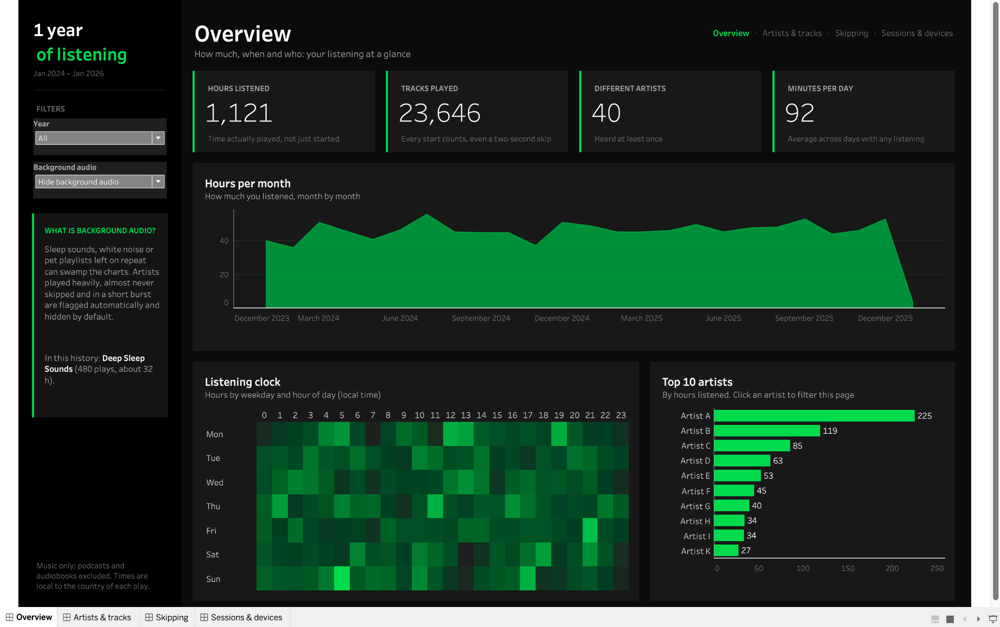
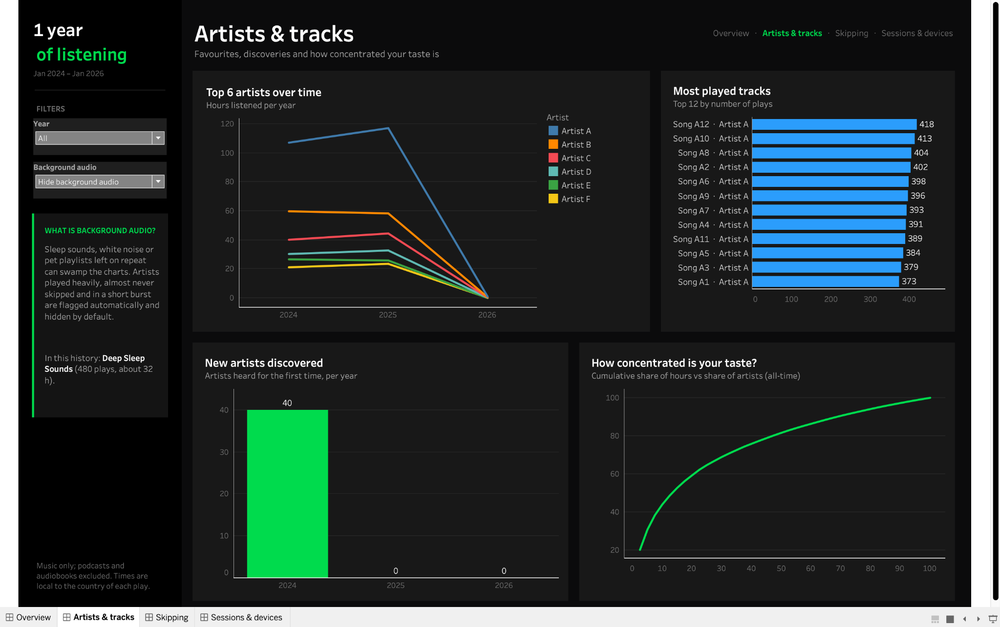
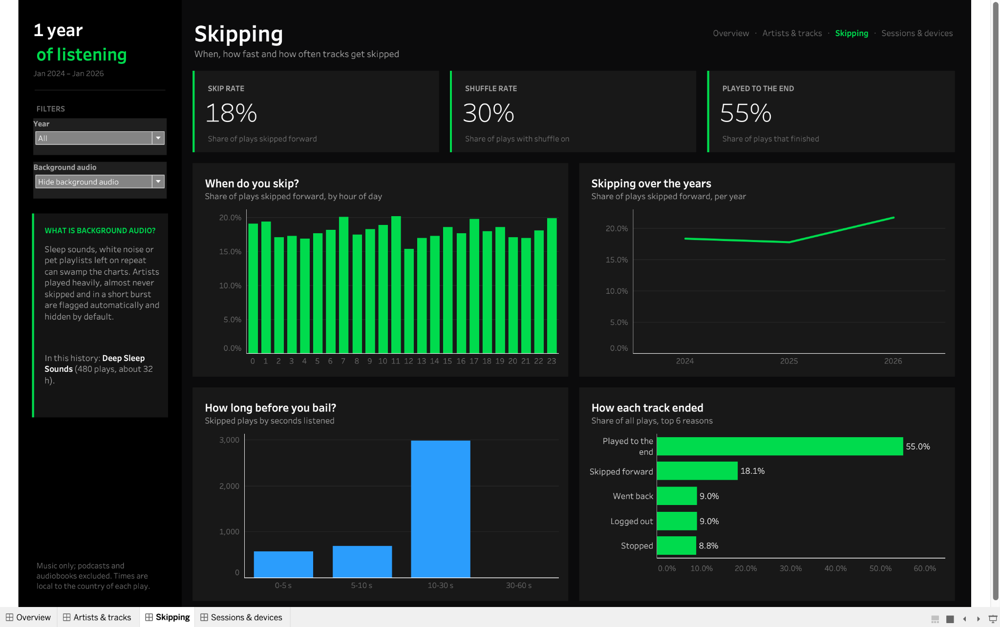
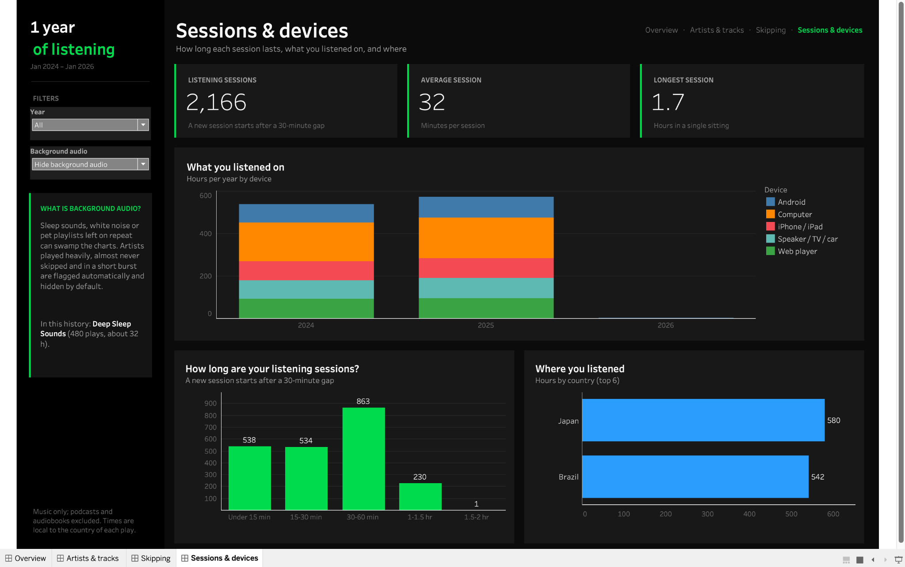

# Spotify Listening Dashboard

**Your Spotify Extended Streaming History → a four-page Tableau dashboard.** Run a Python script locally, open the generated `.twbx` in Tableau Public Desktop, and explore years of listening behavior. No manual chart-building or data upload is required to *generate* the dashboard.



> **Preview uses invented listening records.** All screenshots below were captured from the synthetic sample export, not from a real Spotify account. [Try the demo](#try-it-with-synthetic-data-no-spotify-export-needed).

### What you get

| Page | Explore |
| --- | --- |
| **Overview** | Listening hours, tracks, artists, monthly trends, weekday/hour heatmap, and top artists |
| **Artists & tracks** | Favourite artists and songs, discoveries, and listening concentration |
| **Skipping** | Skip rate, listening duration before skipping, and how tracks ended |
| **Sessions & devices** | Session lengths, devices, and listening countries |

Each dashboard has a year filter; a background-audio switch appears when the tool detects likely ambient/sleep audio. Time ranges and KPIs are generated from the selected dataset.

**[Jump to quick start](#quick-start)** · **[View all four dashboards](#dashboard-gallery)** · **[Privacy notes](#privacy)**

## Quick start

1. **Request** your Spotify **Extended streaming history** (not the basic one-year account export). [Instructions below](#1-request-your-data-from-spotify).
2. **Install** Python and the project dependencies, once. [Mac/Windows setup](#2-set-up-once).
3. **Run** `python make_dashboard.py /path/to/your_spotify_export.zip` inside the activated environment, then open `spotify_listening.twbx` with Tableau Public Desktop. **You do not need to unzip Spotify's export.**

```text
Spotify Extended Streaming History (.zip)
                 ↓
        make_dashboard.py
                 ↓
      spotify_listening.twbx
                 ↓
      Tableau Public Desktop
```

## 1. Request your data from Spotify

You need **Extended streaming history**, not the default **Account data** export (which only covers approximately one year and lacks fields used here).

1. Sign in to [Spotify's privacy page](https://www.spotify.com/account/privacy/).
2. Under **Download your data**, choose **Extended streaming history** and request it.
3. Confirm the request by email, then wait for Spotify's download notification. Spotify says delivery can take **up to 30 days**.
4. Save the downloaded **ZIP** somewhere easy to find, such as **Downloads**. **Do not extract it**: the script reads the ZIP directly.

Spotify may rename its settings. Look for **Privacy settings → Download your data** if the menu has changed. The archive should contain `Streaming_History_Audio_*.json` files (often inside a `Spotify Extended Streaming History` folder).

## 2. Set up (once)

Install **Python 3.10 or later** from [python.org](https://www.python.org/downloads/) and **Tableau Public Desktop** from [Tableau Public](https://www.tableau.com/products/public/download). Tableau is needed to *view and publish* the output; the Python script builds the workbook.

Click **Code → Download ZIP** at the top of this repository, extract the project ZIP, then open a terminal inside the extracted project folder—the one containing `make_dashboard.py` and `requirements.txt`.

**macOS / Linux** (Terminal):

```bash
python3 -m venv .venv
source .venv/bin/activate
python -m pip install -r requirements.txt
```

**Windows** (PowerShell):

```powershell
py -m venv .venv
.venv\Scripts\Activate.ps1
python -m pip install -r requirements.txt
```

If PowerShell blocks environment activation, use Command Prompt instead:

```bat
.venv\Scripts\activate.bat
python -m pip install -r requirements.txt
```

You only install dependencies once per environment. In a new terminal session, return to the folder and reactivate `.venv` before running the script.

## 3. Generate your dashboard

In the activated environment, run:

**macOS / Linux** — replace the filename with your actual Spotify ZIP filename:

```bash
python make_dashboard.py ~/Downloads/my_spotify_data.zip
```

**Windows** — replace the filename and, if necessary, your Downloads path:

```powershell
python make_dashboard.py "$env:USERPROFILE\Downloads\my_spotify_data.zip"
```

Paths with spaces should be wrapped in quotes. You can also pass the path to an already-extracted Spotify export folder.

The script writes **`spotify_listening.twbx`** in your project folder. A successful run looks like:

```text
Reading your Spotify export...
  25,329 plays found. Building tables...
Building the workbook...
Writing Tableau extracts...
Done in 1s: spotify_listening.twbx
```

The numbers, dates, and duration depend on your data; those above are from the synthetic demo.

## 4. Open in Tableau Public Desktop

1. Start **Tableau Public Desktop** and choose **File → Open**.
2. Select **`spotify_listening.twbx`** from your project folder.
3. Explore the **Overview**, **Artists & tracks**, **Skipping**, and **Sessions & devices** tabs; try the year filter and (if visible) the background-audio control.
4. **Optional:** Choose **File → Save to Tableau Public As…** to publish to your Tableau Public profile.

> **Publishing is not private.** Tableau Public makes your visualization and its embedded listening records publicly accessible. Use the synthetic demo for a public portfolio showcase unless you deliberately want to disclose your real history. Never commit your personal Spotify archive or output `.twbx` to a public GitHub repository.

## Try it with synthetic data (no Spotify export needed)

Use the included sample generator to make a wholly invented Spotify-style archive and build the same type of dashboard shown here:

```bash
python tests/make_sample_export.py sample_spotify_data.zip
python make_dashboard.py sample_spotify_data.zip
```

Then open `spotify_listening.twbx` in Tableau Public Desktop. The sample export is **not a real person's listening history**.

## Dashboard gallery

### Artists & tracks



### Skipping



### Sessions & devices



## Compatibility & testing

The following environment was **successfully tested on October 12, 2026** using the included synthetic Spotify history:

| Component | Verified environment |
| --- | --- |
| Tableau | **Tableau Desktop — Public Edition 2026.2.3** (build `20262.26.0912.1023`) |
| Operating system | **macOS, Apple Silicon** |
| Python | **3.14.4** |
| Automated tests | **9 passed** with `pytest` |
| End-to-end demo | **25,329 synthetic plays** processed; `spotify_listening.twbx` generated successfully |
| Visual verification | All four dashboards opened in Tableau Public Desktop |

This establishes compatibility with the version above; other Tableau and Python versions may work but were not independently verified. The synthetic-data results do not guarantee support for every possible Spotify export.

---

## Background audio

Sleep sounds, white noise or a calming playlist for a pet, left playing for hours, can swamp the
charts. The tool flags these automatically and hides them by default, and only then adds a
**Background audio** switch to every page to bring them back. If nothing in your history is
flagged, there is no switch, just a short "About this data" note in its place.

An artist is flagged when **all** of these are true:

- at least 300 plays
- fewer than 2% of those plays were skipped
- at least 60% of the plays fall in that artist's three busiest months

Real favourites get skipped now and then and are spread over time, so they don't qualify.
When something is flagged, the sidebar names it. If the rule gets it wrong, override it:

```bash
python3 make_dashboard.py my_spotify_data.zip --not-background "Some Artist"
python3 make_dashboard.py my_spotify_data.zip --background "Rain Sounds"
```

## Options

| Option | What it does |
| --- | --- |
| `-o FILE` | Where to write the workbook (default `spotify_listening.twbx`) |
| `--note "TEXT"` | A short personal note in the sidebar (under the background-audio explanation, or the "About this data" card) |
| `--link URL` | Adds a "Make your own" link to the sidebar, e.g. to this project |
| `--timezone ZONE` | Use one time zone for every play (e.g. `Europe/London`) instead of each country's |
| `--background ARTIST` | Always treat an artist as background audio (repeatable) |
| `--not-background ARTIST` | Never treat an artist as background audio (repeatable) |
| `--csv FOLDER` | Also save the three tables as CSV files, for other tools |

## How it works

| Step | File |
| --- | --- |
| Read every `Streaming_History_Audio_*.json` in the export, drop exact duplicate rows | `spotify_dashboard/load.py` |
| Convert to local time, label devices and end reasons, find sessions and background audio, build three tables | `spotify_dashboard/transform.py` |
| Generate the dashboard workbook from your data | `spotify_dashboard/workbook.py` |
| Check every field, filter, sheet and action in the workbook resolves | `spotify_dashboard/validate.py` |
| Write the Tableau extracts (Tableau Public requires them) | `spotify_dashboard/extracts.py` |

Some definitions used in the charts:

- **Music only:** podcasts, audiobooks and video are left out.
- **Local time:** each play uses the main time zone of the country Spotify recorded for it. In
  countries with several zones (the US, Canada, Australia, Brazil, Russia and others) that is the
  most populous one, so plays elsewhere in the country are shifted by an hour or more. Use
  `--timezone` if you always listened in one place.
- **Skipped:** the track ended because you pressed "next". Spotify's own `skipped` field is only
  filled in from about 2022, so it isn't used.
- **Session:** a new session starts after more than 30 minutes without playing anything.

## Privacy

- The dashboard generation script processes your listening history locally. Installing dependencies requires downloading Python packages; publishing to Tableau Public sends your workbook to Tableau.
- Spotify's export includes the IP addresses you listened from; the tool never reads them, and they
  are not in the workbook.
- Once you publish to Tableau Public, the dashboard **and the data inside it** (every play, with
  dates, tracks and countries) are public. Check your Tableau Public settings if you don't want
  people to download the workbook.

## Troubleshooting

- **"This looks like Spotify's basic Account data export"**: you requested the default download.
  Request **Extended streaming history** instead (step 1).
- **`No module named ...`**: activate the `.venv` environment and rerun the dependency install command from step 2.
- **Tableau shows an error when opening the file**: please
  [open an issue](../../issues) with the error text (the **Copy Error Message** button) and your
  Tableau Public version (**Tableau Public → About Tableau Public**).

## Development and verification

For an isolated test environment, follow the installation commands in [Set up](#2-set-up-once), then install `pytest` and run the test suite:

```bash
python -m pip install pytest
python -m pytest -v
```

For the tested Tableau version, Python version, and end-to-end results, see [Compatibility & testing](#compatibility--testing).

The tests build complete workbooks from invented histories, so no real listening data is needed.

---

Not affiliated with Spotify or Tableau. Released under the MIT License.
